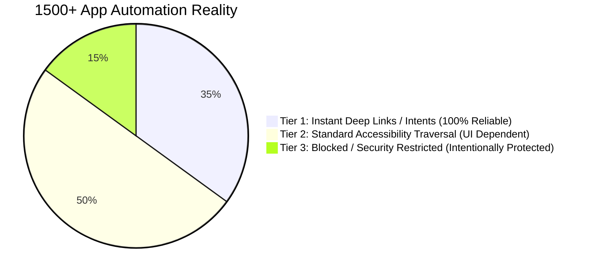
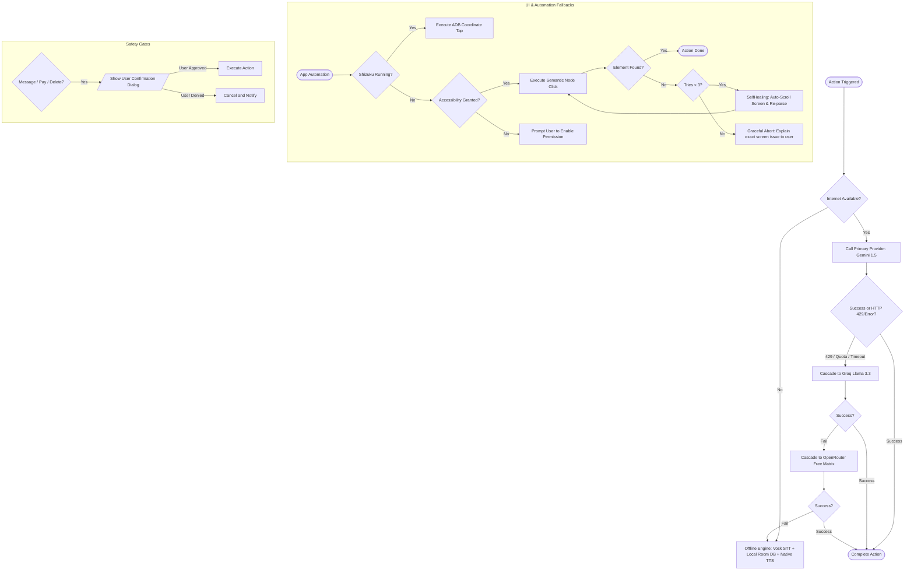
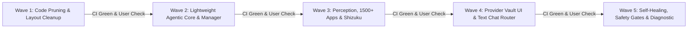

# 🧠 JARVIS Light Agentic Architecture — Blueprint & Master Plan (PLAN.md)

> **प्रोजेक्ट:** JARVIS Android AI Assistant (`Part 7`, Kotlin 2.0.20, Android 8.0+ API 26-34)  
> **थीम व स्टाइल:** 100% Dark Neon Glassmorphism (Cyan `#00E5FF` / Rose Gold `#FF4081`), 3D WebGL Particle Orb, Curved Navigation Dock.  
> **मूल सिद्धांत:** "जो दिखेगा, वो असली में चलेगा — शून्य दिखावा, पूर्ण स्वायत्तता (Zero Placeholders, Pure Execution)।"  
> **दस्तावेज़ स्थिति:** योजना व अनुसंधान चरण (No code modified yet — awaiting user approval).

---

## 📑 विषय-सूची (Table of Contents)
1. **मौजूदा हाल (Current State Inventory):** हर स्क्रीन, फ़ाइल, Agentic vs Pure UI, और हटाने योग्य कचरे की सूची।
2. **मूल लेखक के क्रेडिट्स और LICENSE का ईमानदार विश्लेषण:** TAMCL v1.0 की शर्तें और नया सुव्यवस्थित "Credits" सेक्शन।
3. **सरल Agentic ढाँचा (Lightweight Agentic Framework):** साझा `JarvisAgent` इंटरफ़ेस, Manager, Specialists, और Dynamic Fallback।
4. **गहन Research:**
   - (क) LLM Providers की RPM सीमाएँ, मुफ़्त टीयर्स और Multi-Account Terms of Service।
   - (ख) Android Screen Control के तरीके (Accessibility vs Shizuku vs MediaProjection) और उनकी सीमाएँ।
   - (ग) 1500+ Apps का वास्तविक वर्गीकरण (Intent vs Accessibility vs Blocked/Security Restricted)।
5. **Features की मास्टर सूची (~100 बुनियादी फ़ीचर्स व Top 10 सबसे ज़रूरी)।**
6. **Fail-Safe & Fallback मैट्रिक्स (कठोर If/Else नियम, सुरक्षा गेट्स, Low RAM प्रबंधन)।**
7. **हार्डवेयर-संवेदनशील उपकरण चयन (Hardware & Resource-Aware Tool Selection)।**
8. **नई UI योजना (Dark Neon Wireframes व स्क्रीन्स का खाका)।**
9. **चरणबद्ध क्रियान्वयन क्रम (Wave-by-Wave Execution & CI Verification Checklist)।**

---

## 1. मौजूदा हाल: स्क्रीन व फ़ाइल सूची (Current State Inventory)

### 1.1 स्क्रीन और प्रमुख फाइलों का वर्गीकरण

| फ़ाइल / स्क्रीन | प्रकार | भूमिका (Role) | क्या यह Agent है? | वर्तमान स्थिति | आगामी कार्रवाई (Action) |
|:---|:---|:---|:---:|:---|:---|
| `MainActivity.kt` / `activity_main.xml` | Activity | मुख्य कंटेनर, बॉटम डॉक, ऑर्ब/माइक रूटिंग | ❌ Pure UI | Active | **रिफ़ैक्टर:** डॉक से 'Updates' टैब हटाकर 4 मुख्य टैब (Home, Chat, Agents, Settings) सेट करना। |
| `HomeFragment.kt` / `fragment_home.xml` | Fragment | 3D WebGL Orb, वेदर विजेट, वॉयस स्टेट | ❌ Pure UI / Visuals | Active | **सुरक्षित रखना:** लेगेसी ऑर्ब और वॉयस स्टेट विज्युअल्स 100% बरकरार रहेंगे। |
| `ChatFragment.kt` / `fragment_chat.xml` | Fragment | टेक्स्ट वॉयस चैट इंटरफ़ेस | ❌ Pure UI | Partial (Bypassed) | **क्लीनअप:** नकली चिप्स (`chipPersona`, `chipMode`, `btnAttach`) हटाना; सीधे `SmartProviderRouter` से जोड़ना। |
| `JarvisConversationService.kt` | Foreground Service | वॉयस रिकॉर्डिंग, वेबसॉकेट, टूल कॉल डिस्पेचर | ⚠️ Semi-Agent | Active (Legacy Gemini Live) | **एकीकरण:** Swarm, FreeLiveSearch और Fallback STT/TTS से जोड़ना। |
| `GeminiLiveWebSocket.kt` | Network / Engine | Gemini Live Bidi ऑडियो स्ट्रीमिंग, 22 टूल्स | ⚠️ Tool Host | Active | **अलाइनमेंट:** टूल #22 (`autonomous_agent_workflow`) को सिस्टम प्रॉम्प्ट में आधिकारिक बनाना। |
| `JarvisAccessibilityService.kt` | Accessibility Service | नोड क्लिक्स, जेस्चर, व्हाट्सएप/यूट्यूब ऑटोमेशन | 🤖 Action Executor | Active | **एकीकरण:** `AccessibilityNodeParser` और `HybridActionDispatcher` से सीधा जोड़ना। |
| `VisualTaskOrchestrator.kt` | Automation Core | स्क्रीन विज़न टास्क इंजन, मल्टी-स्टेप फ्लो | 🤖 Agentic Engine | Active (Legacy) | **अपग्रेड:** पुराने बाउंडिंग बॉक्स की जगह सिमेंटिक ट्री और सेल्फ-हीलिंग लगाना। |
| `ManagerAgent.kt` | Agentic Module | जटिल लक्ष्य विभाजन, स्पेशलिस्ट असाइनमेंट | 🤖 Full Agent (Decider) | Orphaned / Dormant | **सक्रिय करना:** प्रॉम्प्ट में जोड़कर लाइव वॉयस और चैट से चालू करना। |
| `SpecialistAgentPool.kt` | Agentic Module | Device, Search, Navigator, Cognitive एजेंट्स | 🤖 Specialist Agents | Dormant | **सक्रिय करना:** वास्तविक टूल और हाइब्रिड डिस्पेचर से जोड़ना। |
| `DynamicAgentFactory.kt` | Agentic Module | अप्रत्याशित गोल्स के लिए डायनामिक एजेंट्स | 🤖 Dynamic Agent | Dormant | **सक्रिय करना:** स्पेशलिस्ट फेल होने पर ट्रिगर करना। |
| `UserSoulManager.kt` / `SoulDao.kt` | Memory Core | हर्मिस कॉग्निटिव मेमोरी, आदतें, स्टाइल्स | 🤖 Memory Agent | Partially Active | **UI एक्सपोज़र:** सेटिंग्स/मेमोरी स्क्रीन में दिखाना। |
| `AgentSoulManager.kt` | Blackboard Core | मल्टी-एजेंट टास्क बोर्ड, स्टेप लॉग्स | 🤖 State Agent | Disconnected UUIDs | **फिक्स:** `AgentTaskEngine` के साथ टास्क UUID सिंक करना। |
| `SmartProviderRouter.kt` | Router | मल्टी-एलएलएम रूटिंग व 429 सर्किट ब्रेकर | 🤖 Decision Engine | Dormant | **सक्रिय करना:** चैट व फॉलबैक में लाइव चालू करना। |
| `ProviderVault.kt` | Security Core | एन्क्रिप्टेड कीज़ (Groq, DeepSeek, OpenRouter) | ❌ Infrastructure | Dormant (No UI) | **UI देना:** सेटिंग्स में कीज़ डालने का सुरक्षित फ़ील्ड बनाना। |
| `FreeLiveSearchClient.kt` | Search Engine | बिना की वाला DuckDuckGo 4-टियर सर्च | 🤖 Knowledge Tool | Dormant | **सक्रिय करना:** लेगेसी Chrome WebView की जगह मुख्य सर्च टूल बनाना। |
| `SelfHealingEngine.kt` | Diagnostic Core | एरर डायग्नोसिस, ऑटो-स्क्रॉल, री-ट्राई | 🤖 Safety Agent | 0 Invocations | **सक्रिय करना:** टूल फेल होने पर 3-स्टेप हीलिंग लूप में लगाना। |
| `AppCategoryCatalog.kt` | Catalog | 1500+ ऐप्स, डीप इंटेंट स्कीमा | ❌ Knowledge Base | Partial (Names only) | **सक्रिय करना:** `actionQuery` पास करके डीप लिंक्स चालू करना। |
| `AccessibilityNodeParser.kt` | Perception Core | स्क्रीन का सिमेंटिक ट्री (`CompactUiTree`) | 🤖 Perception Agent | 0 Invocations | **सक्रिय करना:** `UiGroundingEngine` की जगह लगाना। |
| `ShizukuBridge.kt` | Shell Engine | ADB शेल क्लिक्स, की-इवेंट्स, परमिशन्स | 🤖 Action Executor | 0 Invocations | **सक्रिय करना:** Tier-3 फॉलबैक के रूप में एक्टिवेट करना। |
| `UpdatesFragment.kt` / `fragment_updates.xml` | Fragment | मिशन कंट्रोल व रिलीज़ चेंगलॉग | ❌ UI View | Active (Static Data) | **रिफ़ैक्टर:** डायनामिक मिशन कंट्रोल बोर्ड बनाना; बग नोट्स हटाना। |
| `SettingsFragment.kt` / `fragment_settings.xml` | Fragment | परमिशन्स, मॉडल्स, वेक-वर्ड, एपीआई कीज़ | ❌ Pure UI | Active | **क्लीनअप:** नकली डायलॉग मेथड्स हटाना; प्रोवाइडर वॉल्ट व क्रेडिट्स जोड़ना। |
| `ApiConnectionActivity.kt` | Activity | जेमिनी मॉडल और कनेक्शन टेस्ट | ❌ Pure UI | Active (Fake Models) | **क्लीनअप:** काल्पनिक नाम (`3.8`, `3.1`) हटाकर आधिकारिक मॉडल आईडी लगाना। |
| `PermissionActivity.kt` | Activity | माइक्रोफोन, ओवरले, एक्सेसिबिलिटी परमिशन | ❌ Pure UI | Active | **सुरक्षित रखना:** यह ज़रूरी सिस्टम ऑथराइजेशन सेंटर है। |
| `VoiceEnrollmentActivity.kt` | Activity | Vosk बायोमेट्रिक वॉइसप्रिंट एनरोलमेंट | 🤖 Security Agent | Active | **सुरक्षित रखना:** ओनर वॉइस सिक्योरिटी के लिए आवश्यक है। |
| `MemoryActivity.kt` | Activity | सेव की गई यादों की सूची (Room) | ❌ Pure UI | Active (Legacy DB) | **अपग्रेड:** Dual-SOUL मेमोरी भी यहाँ दिखाना। |
| `PersonaActivity.kt` | Activity | JARVIS vs NAIRA डुअल पर्सोना | ❌ Pure UI | Active | **क्लीनअप:** रोमांटिक/खिलौना मोड्स हटाना, डुअल कोर (जार्विस/नायरा) रखना। |
| `TaskProgressOverlay.kt` | Floating View | ऑटोमेशन के समय फ्लोटिंग टास्क स्टेटस | 🤖 Feedback Agent | Active (Toy Overhead) | **लाइटवेट करना:** वेबव्यू टॉय अवतार हटाकर क्लीन टेक्स्ट/प्रोग्रेस बार HUD रखना। |

### 1.2 हटाने योग्य बेकार कोड, डमी बटन्स और अनाथ लेआउट्स (Pruning List)
1. **अनाथ फाइल्स (पूरी तरह हटाना):**
   - `ui/chat/ChatHistoryBottomSheet.kt` एवं `res/layout/sheet_chat_history.xml` (0 references).
   - `ui/chat/ChatAdapter.kt` एवं `res/layout/item_chat_turn.xml` (0 references).
   - `ui/orb/OrbHelper.kt` एवं `assets/hud/` (269 लाइनों का पुराना अनयूज़्ड Iron Man ब्रिज).
   - `ui/chat/NairaChatAdapter.kt` (अनरेफ़रेंस्ड 7-लाइन टाइपएलायस).
   - `ui/settings/SettingsActivity.kt` एवं `res/layout/activity_settings.xml` (रेडंडेंट रैपर; फ्रैगमेंट सीधे डॉक में है).
   - `res/layout/item_jarvis_chat_message.xml` (अनाथ डुप्लीकेट; अडैप्टर को प्रॉपर लेआउट पर बाइंड कर फालतू कॉपी हटाना).
2. **नकली बटन्स व फ़ेक टेक्स्ट (साफ़ करना):**
   - `ChatFragment.kt`: `chipPersona`, `chipMode`, `btnAttach`, `btnAssistantPlay` के डमी टोस्ट्स हटाना और इनपुट फील्ड को साफ-सुथरा व कार्यशील बनाना।
   - `UpdatesFragment.kt`: अंदरूनी टेस्ट-फेल्योर नोट्स (उदा. Instagram bulk action limit, Google Flow input diagnostic) हटाना।
   - `activity_api_connection.xml` व `activity_hands_free.xml`: काल्पनिक नाम (`gemini-3.8-live`, `gemini-3.1-flash ~700ms`) हटाकर वास्तविक गूगल एपीआई स्ट्रिंग्स लगाना।
   - `assets/overlay-toys/` (18 HTML फाइल्स) व `OverlayAvatarActivity.kt`: फ्लोटिंग ओवरले को हल्का और बैटरी-फ्रेंडली बनाने के लिए वेबव्यू टॉयज हटाना।

---

## 2. मूल लेखक के क्रेडिट्स और LICENSE का ईमानदार विश्लेषण

### 2.1 TAMCL v1.0 (Tech GPTx Creator License) की वास्तविक कानूनी शर्तें
प्रोजेक्ट की [LICENSE](file:///root/Playlist-main/LICENSE) फाइल में **TAMCL v1.0** दर्ज है। इसकी शर्तें निम्नलिखित हैं:
1. **वीडियो व डिजिटल मीडिया में अनिवार्य शाउटआउट (Mandatory Shoutout):**
   - यदि कोई व्यक्ति इस कोड या आर्किटेक्चर का उपयोग करके **YouTube वीडियो, Shorts, Instagram Reels, पॉडकास्ट या ट्यूटोरियल** बनाता है, तो उसे:
     - **मौखिक क्रेडिट (Verbal):** बोलकर कहना होगा: *"Credit to Tech GPTx for the original JARVIS AI Android source code / project."*
     - **डिस्क्रिप्शन क्रेडिट:** डिस्क्रिप्शन की पहली 3 लाइनों में लिंक देना होगा: `https://github.com/techgptx/Playlist`
     - **ऑन-स्क्रीन वॉटरमार्क:** वीडियो के दौरान ऑन-स्क्रीन टेक्स्ट/ग्राफिक दिखाना होगा।
2. **सोर्स कोड व फोर्क संरक्षण:**
   - कोडबेस, मैनिफ़ेस्ट और UI क्रेडिट्स से मूल कॉपीराइट नोटिस (`Tech GPTx / Rehaan`) को पूरी तरह मिटाया नहीं जा सकता।
3. **व्यक्तिगत व गैर-प्रचारक उपयोग:**
   - व्यक्तिगत उपयोग या निजी संशोधन पर कोई रोक नहीं है, परंतु सार्वजनिक प्रदर्शन या ट्यूटोरियल पर उपरोक्त शर्तें लागू होती हैं।

### 2.2 प्रस्तावित सुव्यवस्थित "Credits & About" समाधान
वर्तमान में लेखक के सोशल लिंक्स 4 अलग-अलग स्क्रीनों (`HandsFreeActivity`, `PrivacyShieldActivity`, `SettingsFragment`, `fragment_settings.xml`) पर 40% स्क्रीन घेरते हैं।  
**समाधान:**  
- पुराने स्पैमी बटन्स को हटाकर **`SettingsFragment`** के नीचे एक बेहद सुंदर, डार्क नियॉन स्टाइल का **"Credits & Acknowledgments"** कार्ड बनाया जाएगा:
  - **मूल लेखक:** Tech GPTx (Rehaan)
  - **ऑफिशियल लिंक्स (सक्रिय):**
    - 📺 YouTube: `https://youtube.com/@TechGptX`
    - 📢 Telegram Channel: `https://t.me/+sYana61LvHdmZmE1`
    - 💬 Telegram Group: `https://t.me/+DmyO7NFUia01YTVl`
    - 📸 Instagram: `https://www.instagram.com/techgptx.ai`
    - 💻 GitHub Repo: `https://github.com/techgptx/Playlist`
  - **लाइसेंस नोटिस:** TAMCL v1.0 का संक्षिप्त सारांश और पूर्ण लाइसेंस देखने का डायलॉग।
- इससे लेखक को 100% सम्मान और विजिबिलिटी मिलेगी और ऐप का मुख्य यूज़र इंटरफ़ेस साफ़, पेशेवर और अव्यवस्था-मुक्त रहेगा।

---

## 3. सरल Agentic ढाँचा (Lightweight Agentic Framework)

अनावश्यक जटिलता से बचते हुए एक सीधा, मजबूत और एक्सटेंसिबल आर्किटेक्चर:

```mermaid
flowchart TD
    User([User Voice / Text Input]) --> Manager[ManagerAgent]
    
    subgraph Core Swarm
        Manager --> GoalDecomp[Goal Decomposer]
        GoalDecomp --> Router{Task Routing}
        
        Router -->|Device & System| DevAgent[DeviceSpecialistAgent]
        Router -->|Live Web & Facts| SearchAgent[SearchSpecialistAgent]
        Router -->|1500+ App Automation| AutoAgent[AutomationSpecialistAgent]
        Router -->|Logic & Analysis| CogAgent[CognitiveSpecialistAgent]
        Router -->|Unknown / Custom Goal| DynFactory[DynamicAgentFactory]
    end
    
    subgraph Execution & Fallback Engine
        DevAgent --> HAD[HybridActionDispatcher]
        AutoAgent --> HAD
        SearchAgent --> FLS[FreeLiveSearchClient]
        CogAgent --> SPR[SmartProviderRouter]
        DynFactory --> DynAgent[Synthesized Micro-Agent]
        
        HAD -->|Tier 1| Intents[Android Deep Links]
        HAD -->|Tier 2| Acc[Accessibility Semantic Parser]
        HAD -->|Tier 3| Shiz[Shizuku ADB Shell]
    end
    
    subgraph Memory & Resilience
        Manager <--> SoulMem[(Dual-SOUL Matrix)]
        HAD -.->|On Failure| Healing[SelfHealingEngine (Max 3 Tries)]
        Healing -.->|Retry| HAD
    end
```

### 3.1 साझा `JarvisAgent` इंटरफ़ेस
```kotlin
interface JarvisAgent {
    val name: String
    val description: String
    val capabilities: List<String>
    
    suspend fun canHandle(goal: String): Boolean
    suspend fun execute(goal: String, context: AgentExecutionContext): AgentExecutionResult
}
```

### 3.2 चार स्थायी स्पेशलिस्ट एजेंट्स (Specialist Agents)
1. **`DeviceSpecialistAgent`:** वॉल्यूम, ब्राइटनेस, फ्लैशलाइट, ब्लूटूथ, वाईफाई, कैमरा, अलार्म, हॉटस्पॉट, और बैटरी स्टेट्स।
2. **`SearchSpecialistAgent`:** बिना किसी एपीआई की के DuckDuckGo और विकिपीडिया से ताज़ा खबरें, मौसम, स्टॉक और तथ्य निकालना।
3. **`AutomationSpecialistAgent`:** 1500+ ऐप्स में डीप-लिंक्स और एक्सेसिबिलिटी के ज़रिये ऑटोमेशन चलाना (व्हाट्सएप मैसेज, यूट्यूब वीडियो, कॉन्टैक्ट कॉल)।
4. **`CognitiveSpecialistAgent`:** मल्टी-स्टेप रीज़निंग, भाषा अनुवाद, सारांश और कोड एक्सप्लेनेशन (स्मार्ट प्रोवाइडर राउटर के ज़रिये)।

### 3.3 डायनामिक फॉलबैक (`DynamicAgentFactory`)
- यदि कोई गोल उपरोक्त 4 स्पेशलिस्ट्स के दायरे से बाहर है (उदा. "मेरे फोन की सारी पुरानी अनयूज्ड APK फाइल्स ढूंढकर लिस्ट बनाओ"), तो `DynamicAgentFactory` तुरंत एक नया माइक्रो-एजेंट सिंथेसाइज़ करेगा जिसके पास सिस्टम प्रॉम्प्ट और ज़रूरी टूल्स होंगे।

---

## 4. गहन Research (Providers, Screen Control, 1500+ Apps)

### (क) Multi-Provider RPM सीमाएँ, मुफ़्त टीयर्स और Multi-Account नियम

| Provider | Free Tier Models | RPM Limit | RPD / TPM Limit | लेटेंसी (Latency) | Terms of Service / Multi-Account नियम |
|:---|:---|:---:|:---:|:---:|:---|
| **Google Gemini** | `gemini-1.5-flash`<br>`gemini-1.5-pro` | **15 RPM** (Flash)<br>**2 RPM** (Pro) | 1,500 RPD<br>1M TPM | ~600ms - 1.2s | **कड़ा प्रतिबंध:** Google Cloud ToS (Sec 1.4) रेट लिमिट को बायपास करने के लिए एक से अधिक प्रोजेक्ट/अकाउंट बनाने को धोखाधड़ी मानता है। ऐसा करने पर पूरे Google Developer Console और API प्रोजेक्ट्स को सस्पेंड किया जा सकता है। |
| **Groq LPU** | `llama-3.3-70b-versatile`<br>`llama-3.1-8b-instant` | **30 RPM** | 14,400 RPD<br>6k-20k TPM | **~250ms (अत्यंत तेज़)** | **मुफ़्त टीयर उपलब्ध:** व्यक्तिगत उपयोग के लिए उदार सीमा। मल्टीपल अकाउंट्स बनाकर एक ही सर्वर/IP से पूल करने पर IP-स्तर का Cloudflare/Rate-limit बैन लगता है। |
| **Cerebras** | `llama-3.1-8b`<br>`llama-3.1-70b` | **30 RPM** | 1M Tokens/Day | **~200ms (1800 tok/s)** | मुफ़्त टीयर व्यक्तिगत डेवलपर्स के लिए है। ऑटोमेटेड अकाउंट फार्मिंग सीधे API कीज़ को रिवोक करती है। |
| **DeepSeek** | `deepseek-chat` (V3)<br>`deepseek-reasoner` (R1) | **कोई मुफ़्त कोटा नहीं** (Pay-as-you-go) | बहुत सस्ती दरें (~$0.14 / 1M tokens) | ~1.5s - 3s | कोई स्थायी मुफ़्त टीयर नहीं है। पहले साइनअप पर $5 क्रेडिट मिलता है। व्यावसायिक उपयोग में अकाउंट पूलिंग की ज़रूरत नहीं है क्योंकि दरें बहुत कम हैं। |
| **OpenRouter** | `*:free` मॉडल्स (Llama, Mistral, Gemma) | **20 RPM** | 200 RPD (Free Matrix) | ~1s - 2s | OpenRouter की प्राइवेसी पॉलिसी के अनुसार मल्टीपल अकाउंट्स से फ्री मॉडल एब्यूज करने पर डिवाइस फिंगरप्रिंट और IP रेंज ब्लॉक हो जाती है। |
| **Local Ollama** | `qwen2.5:1.5b`<br>`llama3.2:1b` (Termux/LAN) | **अनलिमिटेड (0 RPM)** | कोई सीमा नहीं | डिवाइस के CPU/RAM पर निर्भर | **100% लीगल व प्राइवेट।** शून्य बाहरी निर्भरता। फोन के लोकल नेटवर्क पर पीसी या टर्मक्स में चलता है। |

> **नैतिक व तकनीकी निष्कर्ष:** कभी भी एक ही प्रोवाइडर पर फेक अकाउंट्स का लूप न बनाएँ। इसके बजाय, **अलग-अलग प्रोवाइडर्स (Gemini $\rightarrow$ Groq $\rightarrow$ OpenRouter Free $\rightarrow$ Local)** का एक वास्तविक बहु-स्तरीय (Multi-Provider) फ़ॉलबैक कैस्केड सबसे सुरक्षित और अटूट समाधान है।

---

### (ख) Android पर Screen Control के तरीके और उनकी सीमाएँ

| तकनीक (Technology) | काम करने का तरीका | फायदे | तकनीकी सीमाएँ व रुकावटें |
|:---|:---|:---|:---|
| **Accessibility Service** | Android OS एक्सेसिबिलिटी नोड ट्री (`AccessibilityNodeInfo`) को पढ़ता है और `ACTION_CLICK`, `ACTION_SET_TEXT`, `performScrollAction()` निष्पादित करता है। | रूट या पीसी की आवश्यकता नहीं; Android 8+ के हर फोन पर काम करता है; टेक्स्ट या रिसोर्स-आईडी से बटन ढूंढता है। | 1. कस्टम कैनवास या फ्लटर (Flutter) ऐप्स जो सिमेंटिक नोड्स एक्सपोज़ नहीं करते, वहाँ टेक्स्ट नहीं दिखता।<br>2. भारी लेआउट ट्री में नोड ट्रैवर्सल धीमा (~200ms) हो सकता है। |
| **Shizuku (Rootless ADB)** | Android के इंटरनल बाइंडर आईपीसी (`IActivityManager`, `IInputManager`) से जुड़कर सीधे ADB शैल कमांड्स चलाता है। | पिक्सेल कोऑर्डिनेट्स पर डायरेक्ट क्लिक (`input tap X Y`), बैकग्राउंड परमिशन्स ग्रांट करना, फोर्स-स्टॉप, हिडन सेटिंग्स टॉगल। | **रीबूट के बाद डिस्कनेक्ट:** जब तक फोन में रूट न हो, हर बार फोन स्विच ऑफ होने पर वायरलेस डीबगिंग (Wi-Fi Debugging) या पीसी से Shizuku को दोबारा स्टार्ट करना पड़ता है। |
| **MediaProjection (Screen Vision)** | वर्चुअल डिस्प्ले बनाकर स्क्रीन का लाइव फ्रेम-बफर कैप्चर करता है (OCR / Vision मॉडल के लिए)। | स्क्रीन पर जो कुछ भी दिख रहा है उसे टेक्स्ट, आइकन या इमेज के रूप में पहचान सकता है; कस्टम गेम्स पर भी चलता है। | 1. **FLAG_SECURE रुकावट:** बैंकिंग, पासवर्ड और नेटफ्लिक्स स्क्रीन पर काला (Black Screen) आता है।<br>2. लगातार स्क्रीन कैप्चर से बैटरी की खपत और फोन का तापमान बढ़ता है।<br>3. स्टेटस बार में लगातार कास्टिंग आइकन दिखता है। |

---

### (ग) 1500+ ऐप्स का वास्तविक वर्गीकरण (Intent vs Accessibility vs Blocked)



1. **Tier 1: डायरेक्ट Intents और Deep Links (35% ऐप्स — 100% विश्वसनीय व तेज़):**
   - **ऐप्स:** WhatsApp, YouTube, Telegram, Google Maps, Spotify, Phone Dialer, SMS, Chrome, Uber, Ola, Twitter/X।
   - **तरीका:** बिना किसी स्क्रीन क्लिक के सीधे OS इंटेंट से खुलते हैं (उदा. `wa.me/number?text=hi`, `vnd.youtube:videoId`, `google.navigation:q=dest`)।
   - **सफलता दर:** **99.9%** (स्क्रीन रेजोल्यूशन या ऐप UI बदलने से अप्रभावित)।
2. **Tier 2: एक्सेसिबिलिटी सिमेंटिक ऑटोमेशन (50% ऐप्स — मध्यम निर्भरता):**
   - **ऐप्स:** Instagram, Reddit, Clock/Alarm, System Settings, Gmail, Play Store, Amazon, Flipkart, Files।
   - **तरीका:** ऐप को खोलकर सिमेंटिक ट्री में सर्च बार, कार्ट बटन, या टॉगल स्विच को खोजकर क्लिक करना।
   - **सफलता दर:** **85-90%** (यदि ऐप का UI अचानक अपडेट हो जाए तो `SelfHealingEngine` को ऑटो-स्क्रॉल या नए लेबल खोजने पड़ते हैं)।
3. **Tier 3: अवरुद्ध व प्रतिबंधित ऐप्स (15% ऐप्स — जानबूझकर ब्लॉक):**
   - **बैंकिंग व पेमेंट ऐप्स:** Google Pay, PhonePe, Paytm, YONO SBI, HDFC। ये ऐप्स `FLAG_SECURE` लगाते हैं, बायोमेट्रिक्स अनिवार्य करते हैं, और एक्सेसिबिलिटी सर्विस चालू होने पर सुरक्षा खतरे का एरर देकर बंद हो जाते हैं।
   - **DRM प्रोटेक्टेड मीडिया:** Netflix, Amazon Prime, Hotstar (स्क्रीन रिकॉर्डिंग या स्क्रीन रीडिंग पूरी तरह ब्लैक हो जाती है)।
   - **कैप्चा (Captcha) व बोट प्रोटेक्शन:** Cloudflare Turnstile या Google reCAPTCHA वाले वेब पेज।
   - **स्पष्ट नियम:** इन 15% ऐप्स में असिस्टेंट कभी भी सीधे पैसे ट्रांसफर करने या पासवर्ड भरने का प्रयास नहीं करेगा, बल्कि उपयोगकर्ता को संबंधित स्क्रीन खोलकर देगा।

---

## 5. Master Features की सूची (~100 बुनियादी फ़ीचर्स व Top 10)

### 🌟 Top 10 सबसे ज़रूरी फ़ीचर्स (Critical P0 - Immediate Focus)
1. **P0-1:** ऑफलाइन वेक-वर्ड "Hey Jarvis" (Vosk) और ओनर वॉइसप्रिंट सुरक्षा (अनधिकृत आवाज़ रिजेक्ट)।
2. **P0-2:** 3D Particle Orb और डार्क नियॉन UI का बिना किसी लैग के सुचारू संचालन।
3. **P0-3:** मल्टी-प्रोवाइडर ऑटो-कैस्केड (Gemini 1.5 $\rightarrow$ Groq Llama 3.3 $\rightarrow$ OpenRouter $\rightarrow$ Local/Offline)।
4. **P0-4:** बिना किसी API key के मुफ़्त लाइव वेब सर्च (DuckDuckGo 4-Tier FreeLiveSearch)।
5. **P0-5:** व्हाट्सएप वॉइस ऑटोमेशन (कॉन्टैक्ट खोजना, मैसेज भेजना, ऑडियो/वीडियो कॉल लगाना)।
6. **P0-6:** YouTube ऑटोमेशन (सर्च, डायरेक्ट प्ले, फुलस्क्रीन, वॉइस कंट्रोल)।
7. **P0-7:** फोन सिस्टम कंट्रोल (वॉल्यूम, ब्राइटनेस, टॉर्च, ब्लूटूथ, वाईफाई, कैमरा, अलार्म)।
8. **P0-8:** Dual-SOUL मेमोरी (उपयोगकर्ता की आदतें, पसंदीदा ऐप्स, बोलने की शैली को याद रखना)।
9. **P0-9:** संवेदनशील कार्रवाइयों पर सख्त यूज़र कन्फर्मेशन (मैसेज भेजना, डिलीट, वित्तीय स्क्रीन)।
10. **P0-10:** सेल्फ-हीलिंग ऑटोमेशन (UI न मिलने पर ऑटो-स्क्रॉल, मैक्सिमम 3 कोशिश, फिर स्पष्ट स्टेटस)।

---

### विस्तृत फ़ीचर्स सूची (Categories with Priority: P0=ज़रूरी, P1=अच्छा, P2=बाद में)

#### श्रेणी 1: Voice, Audio & Speech Engine (15 फ़ीचर्स)
- [P0] 1. Vosk ऑफलाइन वेक-वर्ड डिटेक्शन ("Hey Jarvis")।
- [P0] 2. ओनर बायोमेट्रिक वॉइसप्रिंट मैचिंग (`model-spk`)।
- [P0] 3. Gemini Live Bidi WebSocket 16kHz PCM लो-लेटेंसी ऑडियो स्ट्रीमिंग।
- [P0] 4. Acoustic Echo Decay Protection (AEDP) — खुद के बोलने पर माइक बंद रखना।
- [P0] 5. Voice Activity Detection (VAD) — बात पूरी होते ही तुरंत रेस्पॉन्स।
- [P0] 6. ऑफलाइन Android TTS फॉलबैक (इंटरनेट कटने पर भी बोलना)।
- [P1] 7. डुअल वॉइस पर्सोना (जार्विस - कूल मेल, नायरा - वार्म फीमेल)।
- [P1] 8. लाइव विजुअलाइज़र बार्स (ऑडियो एम्प्लीट्यूड के अनुसार धड़कना)।
- [P1] 9. बैकग्राउंड ऑडियो रिकॉर्डिंग सर्विस (स्क्रीन ऑफ होने पर भी सुनना)।
- [P1] 10. हिंग्लिश और हिंदी भाषा का प्राकृतिक उच्चारण व समझ।
- [P1] 11. माइक्रोफोन म्यूट/अनम्यूट क्विक टॉगल।
- [P2] 12. कस्टमाइजेबल वेक-वर्ड सेंसिटिविटी स्लाइडर।
- [P2] 13. ऑडियो बफरिंग ऑप्टिमाइजेशन (कमजोर नेटवर्क पर ड्रॉप्स रोकना)।
- [P2] 14. वॉयस स्पीड और पिच एडजस्टमेंट।
- [P2] 15. साइलेंट मोड (बिना बोले सिर्फ टेक्स्ट रिप्लाई)।

#### श्रेणी 2: Dual-SOUL Memory & Cognitive State (14 फ़ीचर्स)
- [P0] 16. User SOUL मैट्रिक्स (कम्युनिकेशन स्टाइल, यूज़र के अक्सर इस्तेमाल होने वाले नाम/स्थान)।
- [P0] 17. रूम डेटाबेस आधारित स्थायी मेमोरी (`user_soul_matrix`)।
- [P0] 18. वॉयस कन्वर्सेशन से ऑटोमैटिक प्रिफ्रेंस लर्निंग।
- [P0] 19. Agent SOUL शेयर्ड ब्लैकबोर्ड (मल्टी-एजेंट स्टेट ट्रैकिंग)।
- [P0] 20. रियल-टाइम स्टेप लॉग्स फ्लो (`AgentStepLogEntity`)।
- [P1] 21. लेगेसी मेमोरी इंपोर्टर (पुराने डेटाबेस से डेटा माइग्रेशन)।
- [P1] 22. मेमोरी व्यूअर व डिलीट स्क्रीन (`MemoryActivity`)।
- [P1] 23. टाइम-अवेयर मेमोरी (सुबह, शाम और रात की प्राथमिकताओं का अंतर)।
- [P1] 24. कॉन्टैक्ट एलियास मेमोरी ("मॉम", "भाई", "बॉस" के वास्तविक नंबर याद रखना)।
- [P2] 25. डायनामिक स्किल सिंथेसिस (बार-बार किए जाने वाले कामों की स्क्रिप्ट बनाना)।
- [P2] 26. मेमोरी एक्सपोर्ट व बैकअप (JSON फाइल में सेव करना)।
- [P2] 27. मेमोरी सर्च और फ़िल्टरिंग।
- [P2] 28. ऑटोमैटिक मेमोरी प्रूनिंग (पुरानी महत्वहीन बातें साफ़ करना)।
- [P2] 29. कॉग्निटिव कॉन्टेक्स्ट कम्प्रेशन (प्रॉम्प्ट टोकन कम रखने के लिए सारांश बनाना)।

#### श्रेणी 3: LLM Providers, Router & Vault (15 फ़ीचर्स)
- [P0] 30. एन्क्रिप्टेड प्रोवाइडर वॉल्ट (`EncryptedSharedPreferences`)।
- [P0] 31. गूगल जेमिनी 1.5 फ्लैश REST व लाइव क्लाइंट।
- [P0] 32. Groq LPU अल्ट्रा-फास्ट क्लाइंट (Llama 3.3 70B & 3.1 8B)।
- [P0] 33. HTTP 429 / Quota Exceeded सर्किट ब्रेकर व ऑटो-कैस्केड।
- [P0] 34. OpenRouter Free Matrix फॉलबैक।
- [P1] 35. DeepSeek V3/R1 REST इंटीग्रेशन।
- [P1] 36. लोकल ओलामा (Ollama LAN / Termux) एंडपॉइंट सपोर्ट।
- [P1] 37. सेटिंग्स में एपीआई कीज़ डालने व टेस्ट करने का सुरक्षित UI।
- [P1] 38. प्रोवाइडर लेटेंसी और हेल्थ स्टेटस मॉनिटर।
- [P1] 39. यूज़र मॉडल प्राथमिकता चयन (Fastest vs Smartest)।
- [P2] 40. कस्टम एंडपॉइंट (Any OpenAI-Compatible URL) सपोर्ट।
- [P2] 41. टोकन यूसेज और दैनिक कोटा काउंटर।
- [P2] 42. टेंपरेचर और मैक्स-टोकन्स एडवांस्ड स्लाइडर।
- [P2] 43. प्रोवाइडर फॉलबैक नोटिफिकेशन (यूज़र को बताना कि मॉडल बदला गया है)।
- [P2] 44. ऑफलाइन मोड में लोकल रूल्स इंजन (बिना एलएलएम के बुनियादी कमांड्स)।

#### श्रेणी 4: 1500+ App Connectors & Automation (16 फ़ीचर्स)
- [P0] 45. Tier-1 ऐप डीप-लिंक डिस्पेचर (WhatsApp, Maps, YouTube, Phone)।
- [P0] 46. व्हाट्सएप टेक्स्ट मैसेज डायरेक्ट सेंड।
- [P0] 47. व्हाट्सएप वॉयस और वीडियो कॉल ऑटोमेशन।
- [P0] 48. व्हाट्सएप "Delete for Everyone" वॉयस कमांड।
- [P0] 49. यूट्यूब वीडियो सर्च और डायरेक्ट प्लेबैक।
- [P0] 50. फोन कॉल लगाना (सिम चयन या डिफ़ॉल्ट सिम से)।
- [P0] 51. कॉन्टैक्ट्स बुक से नाम और उपनाम लुकअप।
- [P1] 52. टेलीग्राम चैट ओपन और मैसेज डिस्पेच।
- [P1] 53. गूगल मैप्स नेविगेशन स्टार्ट ("घर का रास्ता दिखाओ")।
- [P1] 54. स्पॉटिफ़ाई / यूट्यूब म्यूजिक पर गाना बजाना।
- [P1] 55. अलार्म सेट करना और टाइमर लगाना।
- [P1] 56. इंस्टाग्राम प्रोफाइल और रील्स नेविगेशन।
- [P2] 57. कैमरा खोलकर फोटो खींचना।
- [P2] 58. ईमेल ड्राफ्ट तैयार करना (Gmail)।
- [P2] 59. फ्लिपकार्ट/अमेज़न पर प्रोडक्ट सर्च करना।
- [P2] 60. कैलेंडर में इवेंट या रिमाइंडर जोड़ना।

#### श्रेणी 5: Screen Vision, Accessibility & Shizuku (14 फ़ीचर्स)
- [P0] 61. सिमेंटिक नोड पार्सर (`AccessibilityNodeParser`) से स्क्रीन ट्री पढ़ना।
- [P0] 62. टेक्स्ट या कंटेंट डिस्क्रिप्शन से स्क्रीन पर बटन ढूंढना।
- [P0] 63. जेस्चर क्लिक और टैप एग्जीक्यूशन (`dispatchGesture`)।
- [P0] 64. स्क्रीन स्क्रॉल (अप, डाउन, लेफ्ट, राइट)।
- [P0] 65. टेक्स्ट इनपुट और कीबोर्ड टाइपिंग (`ACTION_SET_TEXT`)।
- [P1] 66. Shizuku ब्रिज से बैकग्राउंड कोऑर्डिनेट टैप (`input tap X Y`)।
- [P1] 67. बैक बटन और होम बटन जेस्चर सिमुलेशन।
- [P1] 68. रीसेंट ऐप्स ओपन करना।
- [P1] 69. नोटिफिकेशन शेड नीचे खींचना।
- [P2] 70. MediaProjection स्क्रीनशॉट कैप्चर (विज़न मॉडल के लिए)।
- [P2] 71. ऑन-डिवाइस OCR (स्क्रीन पर लिखे टेक्स्ट को पढ़ना)।
- [P2] 72. पॉपअप और परमिशन डायलॉग्स की पहचान।
- [P2] 73. Shizuku सर्विस स्टेटस डिटेक्टर।
- [P2] 74. स्प्लिट स्क्रीन और मल्टी-विंडो अवेयरनेस।

#### श्रेणी 6: Safety, Security & Self-Healing (13 फ़ीचर्स)
- [P0] 75. संवेदनशील कार्रवाइयों पर यूज़र कन्फर्मेशन डायलॉग (मैसेज, डिलीट, वित्तीय)।
- [P0] 76. जीरो हार्डकोडेड एपीआई कीज़/टोकन्स (सख्त एनक्रिप्टेड वॉल्ट)।
- [P0] 77. बैंकिंग व यूपीआई ऐप्स पर ऑटोमेशन तुरंत रोकना (Safety Gate)।
- [P0] 78. Self-Healing: नोड न मिलने पर ऑटो-स्क्रॉल और दोबारा तलाश (अधिकतम 3 कोशिश)।
- [P0] 79. 3 फेल्योर के बाद ग्रेसफुल स्टॉप और यूज़र को स्पष्ट रिपोर्ट।
- [P1] 80. लो रैम डिटेक्टर (रैम कम होने पर वेबव्यू व एनिमेशन सस्पेंड)।
- [P1] 81. ओवरले परमिशन और एक्सेसिबिलिटी परमिशन लाइव हेल्थ चेक।
- [P1] 82. अनपेक्षित क्रैश रिकवरी (बैकग्राउंड सर्विस ऑटो-रिस्टार्ट)।
- [P1] 83. अनधिकृत वॉयस कमांड रिजेक्शन (ओनर वॉइसप्रिंट मिसमैच)।
- [P2] 84. टास्क टाइमआउट वॉचडॉग (30 सेकंड से ज्यादा अटके टास्क को मारना)।
- [P2] 85. बैटरी ऑप्टिमाइजेशन वॉर्निंग व गाइड।
- [P2] 86. सेफ मोड टॉगल (सिर्फ सवाल-जवाब, कोई ऑटोमेशन नहीं)।
- [P2] 87. ऑटोमेशन एक्टिविटी ऑडिट लॉग (क्या-क्या किया गया उसकी हिस्ट्री)।

#### श्रेणी 7: UI, Themes & Experience (13 फ़ीचर्स)
- [P0] 88. 3D WebGL Particle Orb (टच इंटरैक्शन, वॉयस रिएक्टिव पल्स)।
- [P0] 89. कर्व्ड बॉटम नेविगेशन डॉक (Home, Chat, Agents, Settings)।
- [P0] 90. डार्क नियॉन ग्लास थीम (Cyan & Rose Gold एक्सेंट्स)।
- [P0] 91. फ्लोटिंग टास्क प्रोग्रेस HUD (हल्का, बिना वेबव्यू के)।
- [P1] 92. क्लीन चैट स्क्रीन (मल्टी-प्रोवाइडर पावर्ड, कोड ब्लॉक्स सपोर्ट)।
- [P1] 93. मिशन कंट्रोल बोर्ड (सक्रिय मिशन्स, लाइव स्टेप लॉग्स, SOUL आदतें)।
- [P1] 94. वेदर विजेट कार्ड (लोकल टेम्परेचर व कंडीशन)।
- [P1] 95. मूल लेखक का गरिमापूर्ण "Credits & Acknowledgments" कार्ड।
- [P2] 96. थीम कस्टमाइज़र बॉटम-शीट (कलर पैलेट स्विच)।
- [P2] 97. क्विक सेटिंग्स टाइल (Android Quick Settings से जार्विस चालू करना)।
- [P2] 98. फ्लोटिंग बबल टॉगल (स्क्रीन पर कहीं से भी माइक ऑन करना)।
- [P2] 99. हैप्टिक फीडबैक (बटन टैप और वॉयस डिटेक्ट पर सूक्ष्म वाइब्रेशन)।
- [P2] 100. सेल्फ-टेस्ट डायग्नोस्टिक स्क्रीन (माइक, इंटरनेट, एपीआई, एक्सेसिबिलिटी टेस्ट)।

---

## 6. Fail-Safe & Fallback मैट्रिक्स (कठोर If/Else नियम)

असिस्टेंट कभी भी बिना बताए क्रैश या फ्रीज नहीं होगा। हर स्थिति के लिए पूर्व-निर्धारित नियम:



### कठोर संचालन नियम (Strict Operational Rules):
1. **API विफलता / 429 कोटा:**  
   `यदि (Gemini 429 या नेटवर्क एरर) -> Groq LPU (Llama 3.3) -> OpenRouter Free -> लोकल वॉयस फॉलबैक।` कभी भी एरर टोस्ट फेंककर ऐप बंद न करें।
2. **इंटरनेट कटने पर (Offline Mode):**  
   `यदि (नेटवर्क = डिस्कनेक्टेड) -> Vosk ऑफलाइन वेक-वर्ड + लोकल रूम मेमोरी + नेटिव डिवाइस एक्शन्स (टॉर्च, अलार्म, वॉल्यूम, ऐप लॉन्च)।`
3. **Shizuku अनुपलब्ध होने पर:**  
   `यदि (Shizuku बंद) -> तुरंत Accessibility Service पर स्विच करें।` यदि एक्सेसिबिलिटी भी बंद है, तो यूज़र को सीधे ऑन-स्क्रीन गाइड दिखाएँ।
4. **UI बदलने या नोड गायब होने पर (Self-Healing Loop):**  
   `यदि (टारगेट बटन नहीं मिला) -> कोशिश 1: स्क्रीन को 30% नीचे स्क्रॉल करें -> कोशिश 2: पैरेंट कंटेनर में टेक्स्ट खोजें -> कोशिश 3: सिनोनिम/समानार्थी शब्द ढूँढें।`  
   `यदि (3 कोशिशों के बाद भी फेल) -> रुकें और यूज़र को स्पष्ट बताएँ: "मुझे स्क्रीन पर [बटन का नाम] नहीं मिला, कृपया मैन्युअल रूप से टैप करें।" (कदापि इनफिनिट लूप में न जाएँ)।`
5. **अत्यंत संवेदनशील कार्रवाइयाँ (Strict Safety Gate):**  
   `यदि (व्हाट्सएप मैसेज भेजना, ईमेल भेजना, डेटा डिलीट करना, या पेमेंट स्क्रीन) -> अनिवार्य रूप से कन्फर्मेशन प्रॉम्प्ट दिखाएँ। यूज़र के 'हाँ' कहे बिना कभी सेंड न दबाएँ।`
6. **कम रैम की स्थिति (Low RAM Protection):**  
   `यदि (उपलब्ध RAM < 400MB) -> 3D WebGL ऑर्ब को फ्रीज कर 2D स्टैटिक रिंग में बदलें, बैकग्राउंड वेबव्यू बंद करें, और शुद्ध हेडलेस वॉयस मोड में चलें।`

---

## 7. हार्डवेयर-संवेदनशील उपकरण चयन (Hardware & Resource-Aware Tool Selection)

असिस्टेंट डिवाइस की स्थिति को भाँपकर सबसे कुशल और मुफ़्त टूल पहले चुनेगा:

1. **इंटरनेट व डेटा बचत:**
   - सामान्य प्रश्नों, फैक्ट्स और ताज़ा खबरों के लिए कभी भी भारी एलएलएम कॉल करने से पहले **`FreeLiveSearchClient` (DuckDuckGo)** का उपयोग किया जाएगा (शून्य टोकन लागत, शून्य एपीआई खर्च)।
2. **बैटरी व सीपीयू बचत:**
   - स्क्रीन बंद होने पर या बैकग्राउंड में केवल लो-पावर **Vosk C++ इंजन** चलेगा। जेमिनी वेबसॉकेट केवल वेक-वर्ड डिटेक्ट होने के बाद खुलेगा।
3. **स्पीड प्राथमिकता:**
   - टेक्स्ट चैट में Groq LPU (~250ms) को प्राथमिकता दी जाएगी ताकि चैट में टाइपिंग इफेक्ट तुरंत दिखे।
   - लाइव वॉयस में जेमिनी लाइव वेबसॉकेट का उपयोग होगा ताकि वॉयस-टू-वॉयस बिना किसी टेक्स्ट कन्वर्जन लैग के चल सके।

---

## 8. नई UI योजना: Dark Neon Glassmorphism, Bundled Fonts व Animations

मूल JARVIS की पहचान (3D Particle Orb, Curved Dock, Dark Theme) को रखते हुए इसे आधुनिक बनाया गया है:
- **बंडल्ड फॉन्ट्स (`res/font/` — बिना इंटरनेट के):**
  - हेडर्स व HUD डिस्प्ले: `@font/orbitron_bold` (`orbitron_bold.ttf`)
  - बॉडी व टेलीमेट्री टेक्स्ट: `@font/rajdhani_semibold` और `@font/rajdhani_regular`
- **रंग व ग्लासमॉर्फ़िज्म टोकन्स:**
  - डीप स्पेस कैनवास: `#05080F`, एलिवेटेड ग्लास कार्ड: `#0D1522` (1dp `#1E293B` बॉर्डर के साथ)
  - नियॉन एक्सेंट्स: JARVIS Cyan (`#00E5FF`), NAIRA Rose Gold (`#FF4081`), Live Emerald (`#10B981`)
- **फ्लूइड एनिमेशन व स्किल्स (`.agent/skills/` व `assets/skills/`):**
  - `android-ui-ux-glassmorphic`, `android-fluid-animations`, `agentic-tool-planner`, और `live-web-search` स्किल्स जोड़ी गई हैं।

### 8.1 बॉटम नेविगेशन डॉक (Curved Dock Layout)
- **टैब 1 (Home):** 3D Particle Orb, वेदर कार्ड, लिसनिंग स्टेटस, त्वरित मेमोरी सारांश।
- **टैब 2 (Chat):** साफ-सुथरी AI चैट, प्रोवाइडर इंडिकेटर चिप (उदा. `Groq: Llama 3.3`), कॉपी/शेयर, रियल-टाइम स्ट्रीमिंग।
- **सेंटर बटन (Mic):** फ्लोटिंग नियॉन ग्लोइंग माइक (टैप करने पर वॉयस सेशन शुरू/बंद)।
- **टैब 3 (Agents):** एक्टिव स्वार्म मिशन्स, लाइव स्टेप लॉग्स, और Dual-SOUL आदतें।
- **टैब 4 (Settings):** API वॉल्ट, परमिशन्स, वॉइस एनरोलमेंट, और Credits।

---

### 8.2 स्क्रीन वायरफ्रेम्स (Dark Neon Visual Blueprints)

#### स्क्रीन A: Settings & Provider Vault (`SettingsFragment`)
```text
+-------------------------------------------------------------+
|  ⚙️ SETTINGS & CONFIGURATION               [ JARVIS v2.0 ]  |
+-------------------------------------------------------------+
|  [ 🔐 API PROVIDER VAULT ]                                   |
|  ┌────────────────────────────────────────────────────────┐  |
|  │ Google Gemini: [ AIzaSy...********** ]   [ TEST: ✅ ]  │  |
|  │ Groq LPU:      [ gsk_...************ ]   [ TEST: ✅ ]  │  |
|  │ OpenRouter:    [ sk-or-...********** ]   [ TEST: ⚪ ]  │  |
|  │ DeepSeek:      [ sk-...************* ]   [ OPTIONAL ]  │  |
|  │ Local Ollama:  [ http://192.168.1.5:11434 ]            │  |
|  │ Active Strategy: [ Auto-Failover Cascade (Smart) ▼ ]   │  |
|  └────────────────────────────────────────────────────────┘  |
|                                                             |
|  [ 🛡️ SYSTEM AUTHORIZATION & SECURITY ]                     |
|  • Microphone & Speech Engine:        [ ACTIVE (Vosk) ]     |
|  • Android Accessibility Service:     [ GRANTED ✅ ]        |
|  • Shizuku ADB Shell Bridge:          [ CONNECTED ⚡ ]       |
|  • Owner Voiceprint Biometrics:       [ ENROLLED 🔒 ]        |
|                                                             |
|  [ 👤 ORIGINAL CREATOR & CREDITS ]                          |
|  ┌────────────────────────────────────────────────────────┐  |
|  │ Developed by Tech GPTx (Rehaan)                        │  |
|  │ Original Series: JARVIS Android AI Assistant (Part 1-7) │  |
|  │ [ 📺 YouTube ] [ 📢 Telegram ] [ 📸 Instagram ]        │  |
|  │ License: TAMCL v1.0 (Attribution Preserved)            │  |
|  └────────────────────────────────────────────────────────┘  |
+-------------------------------------------------------------+
```

#### स्क्रीन B: Mission Control & Swarm Blackboard (`UpdatesFragment` का नया रूप)
```text
+-------------------------------------------------------------+
|  ⚡ MISSION CONTROL — MULTI-AGENT SWARM                     |
+-------------------------------------------------------------+
|  [ 🧠 DUAL-SOUL COGNITIVE MATRIX ]                          |
|  ┌────────────────────────────────────────────────────────┐  |
|  │ User Traits: Direct Communication • Evening Active     │  |
|  │ Learned Aliases: "Dad" -> +919876... • "Home" -> Flat 4│  |
|  │ Top Skills: WhatsApp Quick Messaging, Music Automation │  |
|  └────────────────────────────────────────────────────────┘  |
|                                                             |
|  [ 🤖 ACTIVE SWARM MISSIONS & TASKS ]                        |
|  ┌────────────────────────────────────────────────────────┐  |
|  │ 🎯 Goal: "Send WhatsApp to Rahul saying I am in traffic"│  |
|  │ ↳ Delegated To: AutomationSpecialistAgent              │  |
|  │ ↳ Status: [ IN_PROGRESS ] -> Resolving Contact...      │  |
|  │ ↳ Safety Gate: Awaiting User Voice Confirmation        │  |
|  └────────────────────────────────────────────────────────┘  |
|                                                             |
|  [ 📜 REAL-TIME STEP LOGS ]                                 |
|  • 12:04:12 [INFO] ManagerAgent decomposed user intent      |
|  • 12:04:13 [SUCCESS] ContactResolver found 'Rahul' (+91...) |
|  • 12:04:14 [WARNING] Deep link prepared; showing confirm UI|
+-------------------------------------------------------------+
```

#### स्क्रीन C: Self-Test & Diagnostic Center
```text
+-------------------------------------------------------------+
|  🩺 JARVIS SELF-DIAGNOSTIC TEST CENTER                      |
+-------------------------------------------------------------+
|  [ RUN COMPREHENSIVE SYSTEM AUDIT ]                         |
|  ┌────────────────────────────────────────────────────────┐  |
|  │ 1. Microphone Hardware & 16kHz PCM:    [ PASS 0.4ms ]  │  |
|  │ 2. Vosk Offline Model & Acoustics:     [ PASS 12MB ]   │  |
|  │ 3. Gemini Live Bidi WebSocket:         [ CONNECTED ]   │  |
|  │ 4. Groq Ultra-Fast LPU Client:         [ PASS 210ms ]  │  |
|  │ 5. Free Live Search (DuckDuckGo):      [ PASS 480ms ]  │  |
|  │ 6. Accessibility Node Parser:          [ ACTIVE ]      │  |
|  │ 7. Shizuku Shell Communication:        [ READY ]       │  |
|  │ 8. Room Dual-SOUL Persistence:         [ SOUND ]       │  |
|  └────────────────────────────────────────────────────────┘  |
|  Overall Status: 🟢 100% OPERATIONAL & READY                |
+-------------------------------------------------------------+
```

---

## 9. चरणबद्ध क्रियान्वयन क्रम (Phased Waves & CI Verification)

काम को 5 सुरक्षित चरणों (Waves) में विभाजित किया गया है। **हर चरण के बाद GitHub Actions (`.github/workflows/build.yml`) से APK बिल्ड होगा, हरा (GREEN) होने की पुष्टि की जाएगी, और यूज़र की सहमति के बाद ही अगला चरण शुरू होगा:**



### Wave 1: कोड क्लीनअप, अनाथ फाइल्स हटाना व लेआउट सुदृढ़ीकरण
* [ ] 1.1 `ChatHistoryBottomSheet.kt`, `ChatAdapter.kt`, `OrbHelper.kt`, `NairaChatAdapter.kt`, और `SettingsActivity.kt` को सुरक्षित रूप से हटाना।
* [ ] 1.2 `item_jarvis_chat_message.xml` को अडैप्टर से बाइंड कर अनाथ डुप्लीकेट को साफ़ करना।
* [ ] 1.3 `fragment_chat.xml` से नकली टोस्ट चिप्स हटाकर साफ-सुथरा इनपुट फील्ड बनाना।
* [ ] 1.4 `SettingsFragment` में मूल लेखक के लिए गरिमापूर्ण **Credits & About** कार्ड जोड़ना और अन्य स्क्रीन्स से स्पैमी सोशल बटन्स हटाना।
* [ ] 1.5 **सत्यापन:** Git commit $\rightarrow$ Push $\rightarrow$ GitHub Actions CI हरा होना।

### Wave 2: सरल Agentic ढाँचा व Swarm एकीकरण
* [ ] 2.1 `JarvisAgent` साझा इंटरफ़ेस परिभाषित करना।
* [ ] 2.2 `DeviceSpecialist`, `SearchSpecialist`, `AutomationSpecialist`, `CognitiveSpecialist` को क्रियाशील बनाना।
* [ ] 2.3 `PromptGenerator.kt` में टूल #22 (`autonomous_agent_workflow`) के लिए आधिकारिक प्रॉम्प्ट नियम और उदाहरण जोड़ना ताकि Gemini Live जटिल लक्ष्यों को सीधे `ManagerAgent` को सौंपे।
* [ ] 2.4 `JarvisConversationService` और `AgentTaskEngine` के बीच Task UUID मिसमैच ठीक करना ताकि मिशन्स हमेशा `IN_PROGRESS` पर न अटकें।
* [ ] 2.5 **सत्यापन:** Git commit $\rightarrow$ Push $\rightarrow$ GitHub Actions CI हरा होना।

### Wave 3: स्क्रीन विज़न, 1500+ App Connectors व Shizuku
* [ ] 3.1 `AccessibilityNodeParser` को `VisualTaskOrchestrator` से जोड़ना (पुराने बाउंडिंग बॉक्स की जगह सिमेंटिक ट्री लगाना)।
* [ ] 3.2 `AppCategoryCatalog` के डीप इंटेंट स्कीमा को `actionQuery` पास करके सक्रिय करना (WhatsApp, YouTube, Maps, Spotify)।
* [ ] 3.3 `HybridActionDispatcher` के Tier 1 (Intents), Tier 2 (Accessibility), और Tier 3 (Shizuku) को आपस में बाँधना।
* [ ] 3.4 **सत्यापन:** Git commit $\rightarrow$ Push $\rightarrow$ GitHub Actions CI हरा होना।

### Wave 4: Provider Vault UI व स्मार्ट टेक्स्ट चैट
* [ ] 4.1 `SettingsFragment` में Groq, Gemini, OpenRouter कीज दर्ज करने और टेस्ट करने का डार्क नियॉन कार्ड बनाना।
* [ ] 4.2 `ChatFragment` को सीधे `SmartProviderRouter` से जोड़ना ताकि बिना वॉयस सर्विस चालू किए भी टेक्स्ट चैट काम करे।
* [ ] 4.3 HTTP 429 कोटा खत्म होने पर Gemini से Groq और OpenRouter पर ऑटो-कैस्केड चालू करना।
* [ ] 4.4 `UpdatesFragment` के मिशन कंट्रोल में हार्डकोडेड टेक्स्ट हटाकर लाइव प्रोवाइडर हेल्थ और सक्रिय टास्क दिखाना।
* [ ] 4.5 **सत्यापन:** Git commit $\rightarrow$ Push $\rightarrow$ GitHub Actions CI हरा होना।

### Wave 5: Self-Healing, Safety Gates व अंतिम सिस्टम सत्यापन
* [ ] 5.1 टूल फेल होने पर `SelfHealingEngine` के 3-स्टेप लूप (ऑटो-स्क्रॉल, री-सर्च, ग्रेसफुल स्टॉप) को जोड़ना।
* [ ] 5.2 मैसेज भेजने, डिलीट करने और बैंकिंग स्क्रीन पर सख्त यूज़र कन्फर्मेशन डायलॉग लगाना।
* [ ] 5.3 लो-रैम (<400MB) प्रोटेक्शन लागू करना (ऑर्ब को लो-पावर मोड में डालना)।
* [ ] 5.4 `verify_agentic_system.py` को अपडेट कर सभी नए ब्रिजेस, कीज़ और लेआउट्स का 100% पास सत्यापन करना।
* [ ] 5.5 **सत्यापन:** Git commit $\rightarrow$ Push $\rightarrow$ GitHub Actions फाइनल ग्रीन APK जेनरेशन (`jarvis-debug-apk`)।

---
*(इस मास्टर प्लान को `/root/Playlist-main/PLAN.md` में सुरक्षित कर दिया गया है। जब आप समीक्षा कर अपनी 'हाँ' या कोई संशोधन बताएंगे, तभी कोड का संपादन शुरू किया जाएगा।)*
